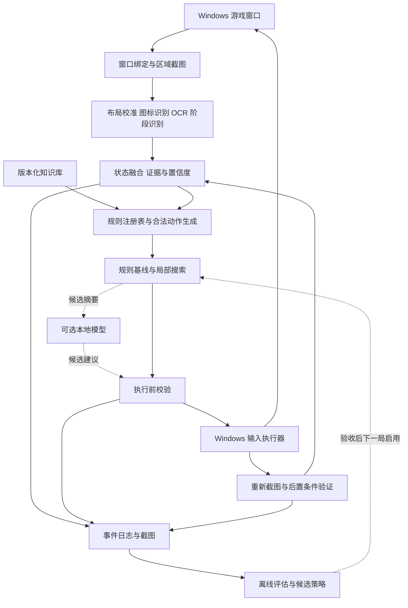
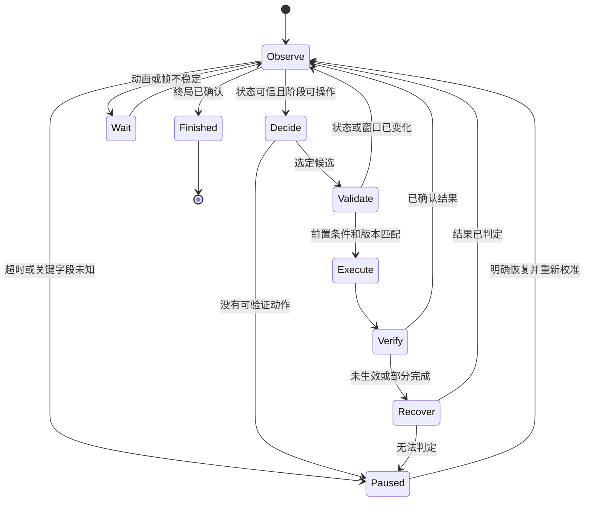

# Agent 架构设计

本设计把游戏自动操作拆成观察、建模、选择、执行和验证五个阶段。只有通过前置条件校验的动作能够进入输入执行器；每个动作完成后重新观察，再决定下一步。

适用平台、选型依据与现状见 [技术选型](README.md)。本文的目录、接口、状态枚举和配置均为待实现设计，不表示仓库已经具备这些能力。

## 1. 运行结构



游戏与 Agent 主循环运行在 Windows。视觉识别和规则搜索优先使用 CPU，给游戏与可选模型留出 GPU 资源。模型服务是独立进程，通过本机 HTTP 连接；关闭模型服务不影响观察、规则策略和输入控制。

主循环只有一个输入所有者。截图、日志写入或模型请求可以异步处理，但同一时刻最多有一个待验证的游戏动作。禁止两个任务同时点击同一个窗口。

### 1.1 模块职责

| 模块 | 输入 | 输出 | 约束 |
|---|---|---|---|
| `capture` | 窗口标识、校准配置 | `Frame` | 记录客户端区域、物理像素大小、DPI 和采集时间 |
| `perception` | `Frame`、模板与 ROI | `Observation` | 保留原文、置信度、候选实体与截图证据 |
| `state` | 当前观察、上次已确认状态 | `GameState` | 不把未知字段补成 0；处理实例跟踪和观察失效 |
| `knowledge` | 内部键、版本信息 | 实体定义、规则引用 | 类型与实例分开，不执行描述中的任意代码 |
| `rules` | 状态与动作 | 合法候选、前置条件、预测范围 | 合法性和可精确预测性分开报告 |
| `planner` | 候选、评价模型、预算 | `ActionProposal` | 只使用合法候选，注明估算和剪枝范围 |
| `model_advisor` | 状态摘要、候选、相关知识 | 候选 ID 或放弃建议 | 没有直接输入权限，不覆盖规则约束 |
| `executor` | 已验证动作、当前坐标映射 | `ExecutionReceipt` | 逐步提交输入，保留部分完成状态 |
| `verifier` | 前后观察、动作预期 | 确认、未生效、部分完成、未知 | 不用单一像素变化证明成功 |
| `trace/eval` | 事件、截图、版本 | 轨迹、指标、可复现失败用例 | 预测和实测值分开，保留失败样本 |

## 2. 状态机与主循环

### 2.1 游戏阶段

阶段由可观察的控件与画面共同识别，不能只根据上一条动作推断。

| 阶段 | 可以考虑的游戏动作 | 转换依据 |
|---|---|---|
| `menu` | 在已验证菜单中开始或载入 | 正确菜单、当前存档与按钮均可识别 |
| `turn_ready` | 开始回合/掷骰 | 以真实游戏控件为准，不假定存在额外按钮 |
| `dice_edit` | 挪移、冻结状态调整、重掷、确认发射 | 骰子、资源和可用按钮均已观测 |
| `resolving` | 无新游戏动作 | 等待计分、生成和动画结束 |
| `shop` | 购买、刷新、冻结、结束商店 | 价格、库存、目标格和资源可识别 |
| `targeting` | 完成当前购买/法术的目标选择，或取消 | 已识别选择中的物品和目标要求 |
| `reward` | 专长、奖励或 Boss 机制选择 | 当前可选项都有定义和输入映射 |
| `paused` | 仅明确的恢复流程 | 已知暂停菜单或人工接管 |
| `terminal` | 保存结果；按运行配置结束或准备下一局 | 胜负/退出画面已确认 |
| `unknown` | 无游戏动作 | 重新识别；持续未知则暂停 Agent |

这是设计分类，不是对实际 UI 顺序的断言。采集阶段要录制完整的回合、商店和奖励流，确定实际转换，再把合法边写入状态机。

### 2.2 控制状态



主循环顺序如下：

1. 检查停止信号、窗口存活、前台窗口和校准版本。
2. 采集稳定帧，识别阶段、实体、资源与关键数字。
3. 将观察融合为带证据的状态；检查当前动作所需字段。
4. 生成合法候选并评价；必要时请求模型建议。
5. 检查观察是否过期、候选是否仍合法、窗口是否仍一致。
6. 落盘动作意图，执行一个游戏动作或受控 UI 子步骤。
7. 等待可观察结果，重新采集，验证后置条件并落盘。
8. 根据验证结果继续、恢复或暂停。

模型返回时如果 `state_revision` 已变化，丢弃该结果。发生用户输入、窗口移动、失焦或分辨率改变时，立即使旧坐标和候选失效。

## 3. 观察与状态契约

### 3.1 Frame 与 Observation

`Frame` 至少包含 `frame_id`、`captured_at`、`window_id`、客户端区域、像素尺寸、DPI、`calibration_id`、图片路径及哈希。截图只保留游戏区域，减少无关桌面内容进入日志。

每个观察字段使用统一封装：

| 字段 | 含义 |
|---|---|
| `value` | 已解析值；未确认时允许 `null` |
| `status` | `observed`、`inferred`、`unknown` 或 `conflict` |
| `confidence` | 识别器分数；未经校准不得解释为正确概率 |
| `source` | 例如 `template`、`ocr`、`temporal_tracker`、`manual` |
| `evidence` | `frame_id`、ROI、识别原文、候选与匹配分数 |
| `observed_at` | 最近一次真实观察时间，跨帧继承不能刷新这个时间 |

两次观察一致只是稳定性信号，不能证明识别正确。关键数字要同时通过字段语法、范围、资源关系和动作前后关系检查。

### 3.2 GameState 必备内容

| 对象 | 字段或语义 |
|---|---|
| 版本 | `schema_version`、`episode_id`、`state_revision`、`observation_id`、`game_build`、`kb_hash`、`ruleset_version`、`calibration_id` |
| 进度 | `phase`、`chapter`、`act`、`target_id`、`turn_index`、`turns_left`、胜负状态 |
| 玩家 | 指挥官内部键、专长、星座、挑战与调整项、心心 |
| 骰子 | `instance_id`、类型、点数/特殊面、列、冻结、裂纹、`roll_id`、本次掷骰是否已挪移 |
| 棋盘 | 6 列及实际可用格子；每格为 `occupied`、`empty`、`unavailable` 或 `unknown` |
| 单位 | 实例 ID、定义键、列/行、当前力量、护盾、充能、电击、重复及本回合临时状态 |
| 神器 | 实例 ID、定义键、列、等级、XP、星界/诅咒属性、锁定状态 |
| 资源 | 挪移、时空点、货币、临时倍率、迷你骰，以及指挥官专用资源 |
| 目标 | 可见防御、累计攻击、当前回合原始/结算攻击、是否已确认击败、余下回合 |
| 商店 | 稳定实例 ID、类别、定义键、实际价格、心心代价、冻结、可购买状态 |
| 界面 | 可点击目标框、按钮可用性、选择中的物品、弹窗、输入阻塞状态 |
| 可信度 | 缺失字段、冲突、未支持效果、可执行动作范围 |

定义键不等于实例 ID。多个米戈必须保留各自位置和力量；购买、死亡重生、随机换位和重掷后重新确认身份。无法连续跟踪时，不沿用旧 ID 执行选择。

行坐标在内部统一约定为 `row=1` 表示最下行。图像坐标原点在左上方，由布局模块转换。需要验证实际可建造格子，不能因为画面有空白就推断该格可放置。

数值契约使用整数或十进制字符串，禁止将得分直接序列化为 JSON 浮点数。指数记法必须整体解析；例如 `1.2e30` 不能读取成 `1`。UI 缩写或舍入导致的不确定值保存为上下界；范围相交时不能宣称已达标。

`Decimal` 的精度和舍入方式要按已验证规则配置，不能靠更换数值类型自动复现游戏内部行为。无尽模式超大数和未知显示记法不属于首版保证范围。

### 3.3 知识库适配

用适配器统一不同来源字段：单位/神器使用 `key`，法术/指挥官/Boss 使用 `k`；原字段保留，内部索引统一为 `(entity_kind, entity_key)`。`artifacts` 数组包含六类实体，不能全部当成可购买神器。

`MegaBlob` 专长与 `Megablob` 指挥官等键存在大小写区别，映射必须来自明确关系，不能统一转小写。`[#]` 仍是待解释的成长占位，缺少成长系数时不能靠等级自行补算。

知识查询包含当前单位、神器、Boss 技能、商店候选及显式关联规则。社区策略作为带来源的建议，与游戏提取描述和已验证效果函数分开存放。游戏 build 或知识哈希变化后，原规则验证结果不能自动沿用。

## 4. 视觉识别与坐标映射

首次校准记录目标窗口、客户端区域、缩放和布局锚点。通过棋盘边框、固定按钮和 HUD 定位 ROI（感兴趣区域），再识别具体实体，禁止把整个桌面宽度均分为六列。

建议处理顺序：

1. 判断窗口有效性、画面稳定性和游戏阶段。
2. 用固定锚点定位棋盘、骰子、资源、商店和按钮区域。
3. 已校准棋盘逐格识别单位、状态图标与数字；商店和神器栏分别处理。
4. 对重复实例保留多处命中；对同一位置的相似模板做候选比较。
5. 读取数值，保留原文和 ROI；对矛盾或缺失字段重新采集。
6. 融合历史状态，输出本帧可用的实体和动作目标。

缓存模板及其缩放结果，优先处理发生变化的区域。阶段转换、窗口移动和关键操作后进行完整重识别。用真实截图测延迟，不继承旧 README 中未经当前设备验证的耗时。

从截图像素到输入坐标的转换必须封装在 `Calibration` 中。转换覆盖 ROI 偏移、客户端到屏幕坐标、DPI 缩放及多显示器原点。输入执行器只接受由当前校准生成且位于目标客户端区域内的点。

Windows 首测使用窗口化/无边框模式。常见 100%、125%、150% 缩放、多屏负坐标和游戏失焦都需要测试；未通过的配置明确禁止自动执行，而不是复用其他配置的坐标。

## 5. 动作契约与合法性

### 5.1 游戏动作与控制动作

| 类别 | 动作示例 | 关键前置条件 |
|---|---|---|
| 骰子 | `budge`、`set_die_frozen`、`reroll`、`launch` | 正确阶段、实例存在、资源足够、骰子状态和 Boss 限制已知 |
| 商店 | `buy_and_place`、`replace_artifact`、`refresh_shop`、`set_offer_frozen` | 价格/心心代价可信、目标可用、受支持的购买效果 |
| 法术 | `cast_spell`，按法术类型约束目标 | 目标数量、相对位置、不可牺牲状态、代价和阶段 |
| 进度 | `finish_shop`、`skip_remaining_turns`、`choose_reward` | 对应按钮存在，游戏状态满足该动作条件 |
| 调试 | `rewind` | 仅显式调试运行开启，记录本轮回退；正式评测默认禁用 |
| 控制 | `observe`、`wait`、`pause`、`stop` | 不作为提升得分的候选，也不消耗游戏资源 |

`set_die_frozen` 表达目标布尔状态，底层右键仍是切换操作。执行前先读当前状态，相同则结束；结果不明时重新读，不连续切换。`buy_and_place` 是一个语义动作，内部可包含多次点击，每个子步骤都需要校验。

模型、策略或用户指定目标都进入同一个校验器。合法性依次检查类型、阶段、实例、资源、目标约束、规则覆盖、前置条件和观察新鲜度。未读取到的价格、骰面或资源不会用默认值替代。

### 5.2 内部候选示例

下面是规则枚举器生成的提案示例，不是模型可以任意填写的执行命令。示例中的快照和 ID 用于解释契约。

```json
{
  "schema_version": "1.0",
  "episode_id": "episode-example",
  "state_revision": 42,
  "observation_id": "obs-42",
  "candidate_id": "candidate-42-3",
  "action": {
    "type": "budge",
    "die_id": "die-2",
    "delta": 1
  },
  "preconditions": {
    "phase": "dice_edit",
    "roll_id": "roll-7",
    "die_value": 2,
    "die_cracked": false,
    "budge": 3
  },
  "expectation": {
    "die_value": 3,
    "die_cracked": true,
    "budge": 2
  },
  "prediction_kind": "exact",
  "decision_source": "greedy"
}
```

此示例只适用于没有改变挪移代价或结果的效果。规则注册表根据实际状态生成前后条件；不能把示例固化为所有指挥官、神器和 Boss 的统一行为。

### 5.3 结果语义

| 结果 | 意义 | 后续处理 |
|---|---|---|
| `confirmed` | 已观测到动作完成的充分证据 | 记录新状态，再规划 |
| `not_applied` | 能证明动作未生效且原前置状态仍成立 | 在该动作允许范围内有限重试 |
| `partial` | 已进入选择态或只完成部分步骤 | 从已知中间状态继续或取消，不能重放整个动作 |
| `unknown` | 无法确认是否已生效 | 重新观察；仍不明则暂停 |
| `rejected` | 执行前校验失败，未发送输入 | 刷新状态或修正候选 |
| `cancelled` | 停止信号中断了流程 | 记录最后已发送子步骤，等待恢复判定 |

操作 ID 只能帮助日志去重，不能让游戏点击获得幂等性。进程在发送输入后崩溃时，重启先观察并核对未完成意图，不能自动重发。

## 6. 规则与局部搜索

### 6.1 规则覆盖分级

| 等级 | 含义 | 决策可使用的结果 |
|---|---|---|
| `exact` | 所有相关效果和顺序已实现，状态数值足够精确 | 确定转移或经过验证的随机分布 |
| `estimated` | 使用局部启发式、概率估计或显示值区间 | 估计收益、风险和不确定性，不能当作已确认 KO |
| `unsupported` | 相关机制、代价、事件顺序或必要状态缺失 | 不生成依赖该机制的自动动作；补观察或接管 |

合法性可验证、得分不可精确预测的动作，只有在预先批准的启发式运行范围内才可选择。首版默认采用受支持规则白名单。任何候选都不能绕过价格、目标和输入条件的硬限制。

事件引擎至少需要区分回合开始、掷骰、发射、单位得分、Repeat、触发、死亡、生成、购买、神器升级和回合结束。`▶` 前后语义、Repeat 不等于新的得分、Shock 对本次得分的影响，都需要独立案例验证。

资料中的结算顺序作为验证假设。记录事件来源和入队顺序，用真实前后状态验证后才标记为精确。对连锁触发设事件预算和重复状态检测；达到上限时返回 `simulation_budget_exceeded`，不能直接宣称收益无限。

### 6.2 基础评分的适用条件

在没有改变力量、重复、触发和倍率的效果时，可以使用列力量与骰子威力的基础公式。复杂局面必须先展开事件，再计算本回合新增攻击和累计进度，避免把已经结算过的得分再次相加。

局部评价优先级采用分层比较：

1. 过滤非法动作、规则不可支持动作和违反保命约束的动作。
2. 比较当前目标的失败风险、达标概率与预计所需游戏回合。
3. 比较归一化攻击进度、可见构筑收益、资源余量和棋盘空间。
4. 收益相近时，优先操作更少、执行风险更低的动作。

没有可靠模型时，不编造达标概率或未来回合数。此时使用显式启发式和不确定性惩罚，并在日志中标记。商店中的无即时分数动作可以通过下一次计分或已验证构筑特征评价，不会因为即时得分为 0 而全部被拒绝。

### 6.3 确定动作与随机动作

挪移、合法放置和已知法术可以枚举当前合法候选。首版先实现深度 1；观察到需要连续配合的动作，再增加固定宽度、固定预算的深度 2 beam 搜索。每个预测节点重新检查资源和目标条件，不能只验证第一步。

重掷的结果在操作前通常不可见。只有在三颗普通公平独立骰、没有改变骰面概率的机制时，才可枚举冻结掩码和最多 `6^3 = 216` 个结果，并按概率计算期望。特殊骰、商店刷新、随机单位触发分别实现分布；分布未知时保持估计或未支持。

随机搜索使用独立、记录在日志中的规划随机种子，不把它冒充游戏随机数状态。同一起始游戏种子也不保证不同策略之后遇到相同随机事件，因为动作会改变随机数的消耗顺序。

配置 `max_candidates`、`max_nodes`、`max_events` 和 `decision_deadline_ms`。预算耗尽则选择已完成评价的合法候选，并记录剪枝信息；没有合格候选则暂停。不能把超时返回称为局部最优。

## 7. 模型辅助层

模型请求包含压缩状态、相关知识条目、候选动作、规则预测、构筑摘要和允许返回的原因码。无需发送全部知识库，也不要求模型重算得分。

模型只返回如下结构：

```json
{
  "state_revision": 42,
  "candidate_id": "candidate-42-3",
  "reason_codes": ["preserve_chrono"]
}
```

`candidate_id` 可为空，表示放弃建议。有效值必须属于本次请求候选集，`reason_codes` 来自预定义枚举。校验通过后还要重新检查状态版本和候选前置条件。

llama.cpp 的 JSON Schema 支持子集，schema 本身也不必然作为提示词出现；适配器同时传输出约束和简短格式说明。vLLM 的结构化输出参数由单独适配器处理，不能假定两个服务的兼容 API 字段完全一致。依据见 [S8、S9](README.md#7-官方技术依据)。

响应截断、超时、格式错误、过期状态或无效候选统一返回规则策略。观察不可信时暂停，不能把「切回规则」当作解决错误输入的方法。模型只在商店选择、奖励选择或 Boss 准备等有实际收益的节点调用。

经验检索先按游戏版本、规则版本、阶段、指挥官和 Boss 过滤，再按构筑特征查找相似局面。只读入人工审查或验证过的经验；相似局面的成功动作仍需按当前状态重新验合法性。

## 8. 输入执行、恢复与停止

执行器将语义目标解析为当前帧中的控件或格子中心，再转换为屏幕绝对坐标。正常点击直接定位并按下/抬起，不使用平滑移动路径。每次操作检查窗口前台、目标边界、DPI 和 `calibration_id`。

购买并放置的执行顺序如下：

1. 记录包含库存实例、价格、目标格和动作 ID 的意图，确认日志可写。
2. 点击已识别的商品。
3. 重新观察，判断购买是否已经完成，或是否进入目标选择态。
4. 只有明确处于正确选择态时才点击目标格。
5. 读取货币、库存、棋盘和阶段变化，验证最终结果。

如果点击商品时已经扣费，步骤 3 超时后不能再点一次商品。需重新识别当前阶段；选择态明确时继续，状态不明时暂停。`SendInput` 返回已注入事件数也不代表游戏已经接受业务动作。

全局停止热键由独立监听器响应。收到停止、失焦、窗口消失或人工接管信号后，禁止提交新的输入；已发送的事件不能撤回，在日志中记录并重新观察。默认遇到用户操作后暂停，需要明确恢复。

错误类别统一为 `CAPTURE_FAILED`、`OBSERVATION_UNCERTAIN`、`STATE_CONFLICT`、`UNSUPPORTED_RULE`、`ACTION_REJECTED`、`INPUT_UNCONFIRMED`、`MODEL_UNAVAILABLE`、`LOG_WRITE_FAILED`。每个错误记录截图、阶段、动作 ID 和恢复结果。

日志持久化失败时停止发出新游戏动作。保留最后可确认状态，修复存储后再观察恢复，避免产生无法复盘的训练轨迹。

## 9. 轨迹、回放与离线学习

### 9.1 存储布局

以下为运行时产物目录设计，应默认加入忽略规则，避免将大量截图、存档或模型权重推入知识库仓库。

```text
runs/<episode_id>/
  manifest.json       # 游戏、代码、知识、规则、策略、模型和硬件版本
  events.jsonl        # 有序追加的原始事件
  frames/             # 初始帧、动作前后帧、异常帧和数值 ROI
  summary.json        # 终局和整局指标
index.sqlite          # 从 manifest/events 重建的查询索引
```

事件类型包含 `episode_started`、`observation_recorded`、`decision_made`、`action_intent`、`input_sent`、`verification_completed`、`recovery_attempted` 和 `episode_finished`。事件具有递增序号、时间、`episode_id`、`action_id` 和状态引用。

关键记录至少包含候选列表/剪枝摘要、实际选择、模型请求版本、预测收益、前后状态、验证结果、真实资源变化、时延与错误类别。`predicted_score`、`observed_score` 和训练标签分开存储，不能把预测值直接作为真实奖励。

每次产生有副作用的输入前先持久化意图；输入后记录实际发送步骤和验证结果。启动时扫描没有终态的意图，重新观察后归类为确认、未生效、部分完成或未知。

### 9.2 回放边界

日志回放用于重跑识别、规则计算和候选选择，不会自动重现真实游戏。没有完整游戏状态和随机数状态时，不能从截图日志恢复游戏任意时刻。

离线回放默认不加载输入执行器。真实游戏重放另用经过验证的存档/种子重置流程，并记录成功与否。Rewind 的相同操作复现应通过实测，不能把它当成尝试所有未来动作的模拟器接口。

### 9.3 策略迭代

每局固定一个 `policy_bundle_id`，包含规则、参数、知识、提示词和可选模型适配器版本。运行中只采集数据。更新过程为：分析失败类别 → 修改候选版本 → 离线回归 → 相同条件对局对照 → 验收 → 下一局启用。

视觉误读与输入失败先用于修复对应模块，不作为策略错误直接训练。策略差但状态可信的失败样本保留；胜局也需检查具体动作是否正确，不能按整局胜负直接给所有步骤贴好坏标签。

SFT 数据来自可信状态与审查过的候选选择。DPO 的优劣动作必须基于同一决策状态，并有可比较的后果证据；两个不同对局的分数高低不能直接组成偏好对。GRPO 需要可重置环境、可靠奖励和足够吞吐，首版不承担这些条件。

按对局和种子族切分训练/验证/测试。测试集不可进入经验检索、提示词示例或参数搜索；另留跨版本、Boss 与构筑分布变化的挑战集。版本升级后保留旧版本和回滚入口。

## 10. 代码组织与配置

建议在现有仓库内新增以下结构，复用 `vision/` 与数据文件。只有当训练依赖或产物管理明显冲突时，再拆独立训练仓库。

```text
agent/
  contracts/          # Frame / Observation / GameState / Action / Event
  runtime/            # 主循环、状态机、停止与恢复
  perception/         # 适配 vision，补 ROI、数值与阶段解析
  knowledge/          # 实体索引、版本和规则关系
  rules/              # 合法性、效果、事件结算、覆盖表
  policy/             # baseline、greedy、beam、model_advisor
  execution/          # Windows 输入、坐标转换、后置验证
  telemetry/          # JSONL、截图与索引
configs/              # 布局、支持范围、运行预算、策略版本
evals/                # 标注截图、规则案例、离线与在线评测入口
training/             # 后续数据导出与独立训练配置
```

运行模式定义为 `observe`（只采集）、`dry_run`（生成候选但不输入）、`assist`（人工逐步选择执行）和 `auto`（在已验收范围内执行）。模式进入日志，评测时不能混合统计人工辅助与自动结果。

关键配置分组如下：

| 分组 | 配置内容 |
|---|---|
| `window` | 目标进程/窗口、客户端区域、支持的分辨率与 DPI |
| `scope` | 游戏 build、章节、指挥官、规则白名单、Rewind 是否允许 |
| `observation` | 帧稳定条件、字段阈值、过期时间、重识别预算 |
| `planning` | 搜索深度、候选/节点/事件预算、超时、策略版本 |
| `model` | 是否启用、端点、revision、schema、上下文/输出预算和超时 |
| `execution` | 校准文件、前后置条件、各动作允许的恢复流程 |
| `logging` | 产物目录、保留策略、磁盘不足时停止条件 |

部署产物锁定代码提交、依赖文件、模板哈希、知识哈希和规则集。更换模型、游戏补丁或 UI 布局后分别触发相关验收；已有测试通过记录不能跨版本自动继承。
